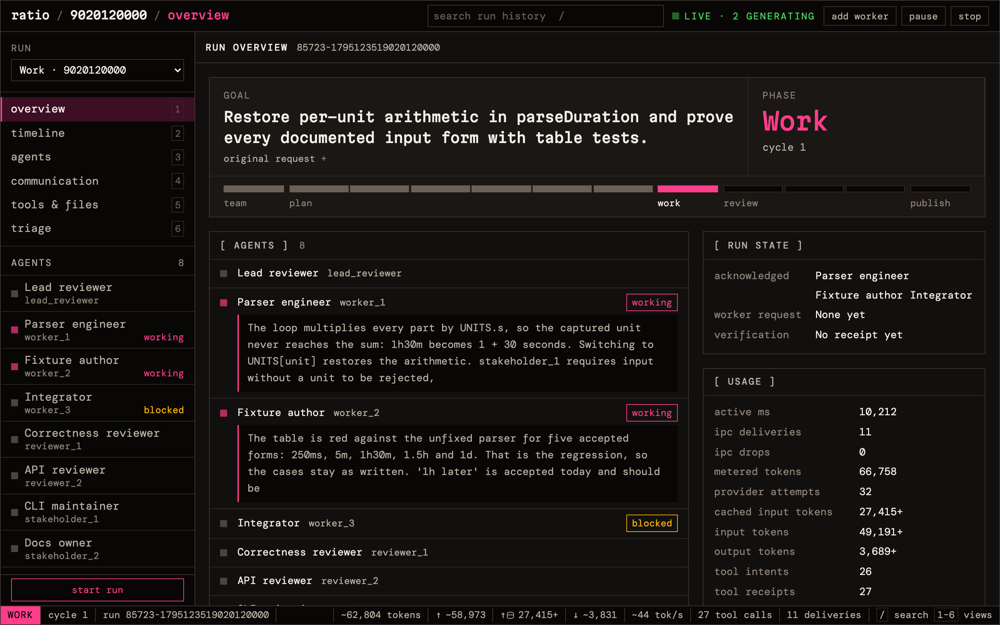
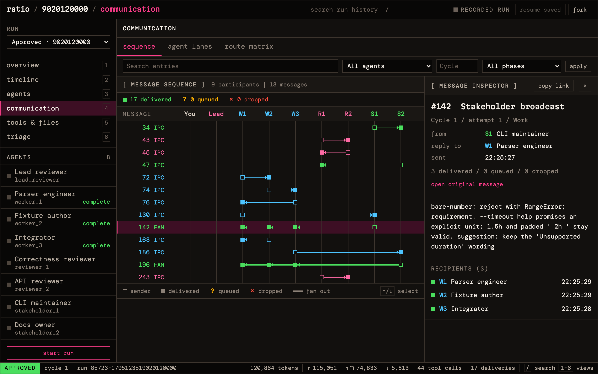
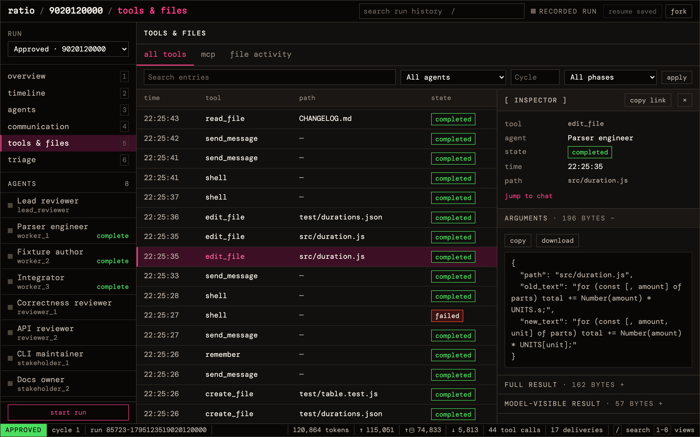
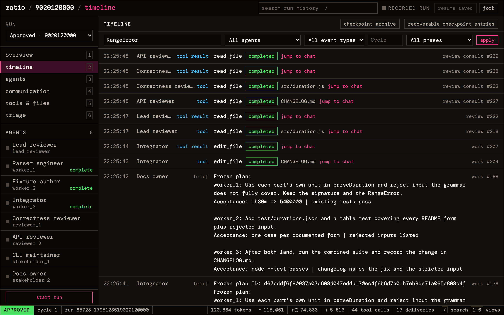
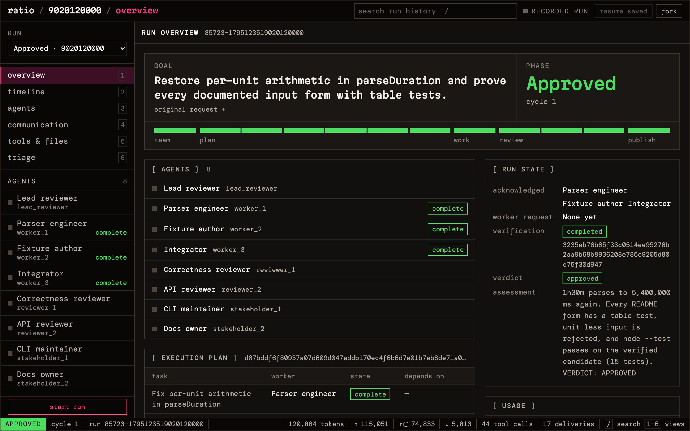
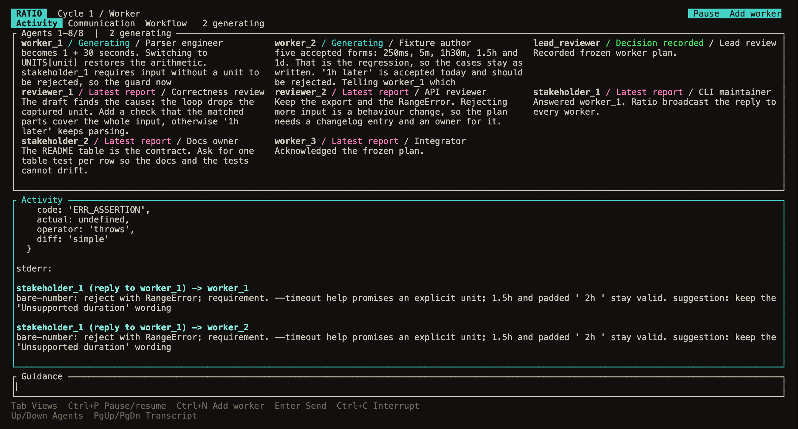
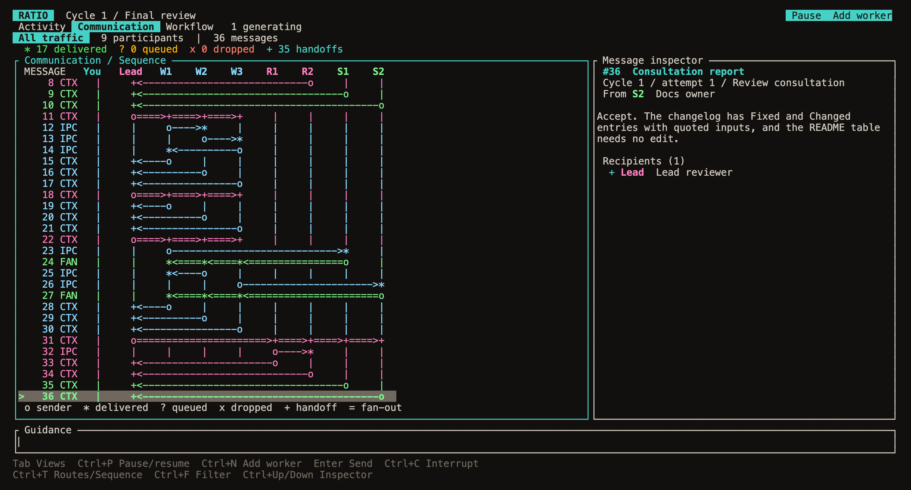

# Ratio

Ratio runs a team of coding agents on your repository and keeps a record of everything they do. Point it at an OpenAI-compatible endpoint, open the dashboard in your browser, and describe what you want. A lead reviewer plans the work, workers agree on who writes which files before anything is edited, stakeholders answer questions mid-run, and a typed verdict decides whether the result reaches your worktree. You watch and steer the whole run from the browser.



<sub>A live run in the dashboard. Two workers are generating, a third is blocked on their tasks, and the status bar meters tokens as they stream. The screenshots in this README come from a [scripted demo run](#development).</sub>

- **One request becomes a team.** Ratio proposes workers, reviewers, stakeholders, and acceptance criteria, or uses the roster you configure.
- **Nobody writes before the plan is frozen.** The lead reviewer freezes assignments and write paths. Every worker acknowledges the exact plan ID, and one objection sends the team back to coordination.
- **Independent work runs in parallel.** A typed task graph releases each worker as soon as its predecessors finish.
- **Your worktree changes only after review.** In staged mode, workers edit private copies, verification commands run on the merged candidate, and publication needs a passing receipt and an approval.
- **Everything is on the record.** Messages, tool calls, results, and budgets go to a local SQLite journal that you can search, export, resume, and fork.
- **Any OpenAI-compatible model.** Use Chat Completions or Responses, streamed or not, with a different model per role or per agent.

**Contents:** [Quick start](#quick-start) | [Configuration](#configuration) | [A run in pictures](#a-run-in-pictures) | [The dashboard](#the-dashboard) | [How a run works](#how-a-run-works) | [Teams, communication, and review](#teams-communication-and-review) | [Workspace and publication](#workspace-and-publication) | [Context, limits, and automation](#context-limits-and-automation) | [Local extensions](#local-extensions) | [Terminal and headless use](#terminal-and-headless-use) | [Development](#development)

## Quick start

You need Rust 1.85 or later, Git, and an OpenAI-compatible API whose model supports function (tool) calling.

**1. Install.** This puts the `ra` binary in `~/.cargo/bin`.

```sh
git clone https://github.com/19h/ratio.git
cd ratio
cargo install --locked --path crates/ratio
```

**2. Describe your provider.** Create `~/.config/ratio/config.toml`. On Windows, use `%APPDATA%\ratio\config.toml`.

```toml
endpoint = "https://api.openai.com/v1"  # base URL of your OpenAI-compatible API
model = "your-model-id"                 # must support function (tool) calling
context_window = 128000                 # the model's context size in tokens
```

`model` and `context_window` have no default, and a run does not start without them. [Configuration](#configuration) explains each setting and lists endpoints for common providers.

**3. Provide the key.** Export it in the shell where you will start Ratio. Skip this step for a local server that needs no key.

```sh
export RATIO_API_KEY='<provider key>'
```

**4. Open the dashboard.**

```sh
ra -C /path/to/project --web
```

Ratio prints a private URL such as `http://127.0.0.1:52814/#access=...`. Open it in your browser. The start page shows the configuration the next run will use, and reports a broken profile before you start. Click **Test provider** to confirm the endpoint, key, and model. Then click **Start run** and describe the outcome you want. Ratio proposes a team, plans, works, and reviews while you watch.

Three things to know before the first run:

- **Workers edit the project in place by default**, and their shell commands run with your permissions. Start on a clean Git branch, or enable [staged publication](#staged-publication) so nothing reaches your worktree before review.
- **Runs have no limits by default.** Set token and time caps in [your first profile](#a-good-first-profile) before a long run.
- **Ratio keeps its journal in `PROJECT/.ratio/`.** It contains transcripts and workspace data, so add `.ratio/` to the project's `.gitignore`.

If **Start run** reports an error, see [When a run does not start](#when-a-run-does-not-start).

## Configuration

### Where settings come from

Ratio reads one profile, a TOML file. It uses `--config FILE` when you pass it. Otherwise it uses the global profile.

| Platform | Global profile |
| --- | --- |
| Linux and macOS | `$XDG_CONFIG_HOME/ratio/config.toml`, or `~/.config/ratio/config.toml` when `XDG_CONFIG_HOME` is unset |
| Windows | `%APPDATA%\ratio\config.toml` |

A setting can come from four places. The first one that provides a value wins.

1. Flags on the `ra` command line, such as `--model` or `--endpoint`
2. `RATIO_*` environment variables
3. The profile
4. `OPENAI_BASE_URL` and `OPENAI_API_KEY`, as a fallback for the endpoint and the key

Three details save a lot of confusion:

- **`--config` replaces the global profile.** The two files are not merged, so a project profile must repeat the endpoint, model, and context window.
- **The profile is strict.** An unknown or misplaced key stops Ratio with `invalid config`, naming the key.
- **Each run reads the profile when it starts.** Edit the file and click **Start run** again. Restart `ra --web` only to change flags or environment variables, because the dashboard passes its own flags and environment to every run it starts.

### The settings every profile needs

| Setting | What to put there | Default |
| --- | --- | --- |
| `endpoint` | The API base URL up to the version prefix, such as `https://provider.example/v1`. Ratio appends `/chat/completions`. A full method URL is also accepted. | `https://api.openai.com/v1` |
| `model` | The model ID exactly as your provider lists it. The model must support function (tool) calling, because agents plan, edit, and submit verdicts through tool calls. | None. Required. |
| `context_window` | The number of tokens the model accepts in one request. For a local server, use the context size the server loaded the model with, which can be smaller than the model's maximum. With several models in one run, use the smallest. | None. Required. |
| `output_tokens` | The cap on a single reply. It must be smaller than the context window. | A quarter of the context window, at most 4096 |
| Key | Set `RATIO_API_KEY` in the environment. `api_key = "..."` in the profile also works. Keep that file private. | None. Optional for servers without authentication. |

The default reply cap of 4096 tokens is conservative. If your model supports longer replies, raise `output_tokens`. A reply that reaches the cap is discarded and retried with a request for brevity, which costs time and tokens.

### Endpoints for common providers

| Provider | `endpoint` | Key |
| --- | --- | --- |
| OpenAI | `https://api.openai.com/v1` (the default) | `OPENAI_API_KEY` is picked up automatically |
| OpenRouter | `https://openrouter.ai/api/v1` | `RATIO_API_KEY` |
| MorphLLM | `https://api.morphllm.com/v1` | `RATIO_API_KEY` |
| Ollama | `http://localhost:11434/v1` | Not needed |
| LM Studio | `http://localhost:1234/v1` | Not needed |
| llama.cpp `llama-server` | `http://localhost:8080/v1` | Not needed |
| vLLM | `http://localhost:8000/v1` | Not needed |

The local ports are each server's default. Any other OpenAI-compatible gateway works the same way. If yours rejects a request field, see [When a run does not start](#when-a-run-does-not-start).

### A good first profile

```toml
endpoint = "https://provider.example/v1"
model = "your-model-id"
context_window = 128000
output_tokens = 8192

[orchestration]
# Stop a run that goes too far. Omit a limit or set it to 0 for unlimited.
max_review_cycles = 3
max_total_tokens = 8000000
max_run_secs = 3600
```

A run that reaches a cap ends as **Exhausted** and keeps its history. Raise the cap and click **Resume saved** to continue the same run. [Limits](#limits) lists every cap.

To use different models per role, add `[worker]` and `[reviewer]` tables with their own `model`. To skip team generation for a small task, start the dashboard with `--fixed-team`. Ratio then uses your configured roster, or one built-in worker when the profile has none.

### Project profiles

Settings that belong to one project, such as verification commands, a fixed roster, or MCP servers, go in a profile you pass explicitly.

```toml
# PROJECT/ratio.toml
endpoint = "https://provider.example/v1"
model = "your-model-id"
context_window = 128000

[orchestration]
stage_workspace = true
verification_commands = ["npm test"]
```

```sh
ra -C PROJECT --config PROJECT/ratio.toml --web
```

This profile turns on [staged publication](#staged-publication). Workers edit private copies, `npm test` runs on the merged candidate, and your worktree changes only after the reviewer approves a candidate that passed. Staging needs the root of a Git worktree and at least one verification command. Without `stage_workspace`, the same [verification commands](#verification-commands) run in the live workspace and still block approval when they fail.

More starting points:

- [`ratio.example.toml`](ratio.example.toml) lists the common settings with comments. It also sets a `goal` and Rust-specific constraints, so edit those before you reuse it.
- The [stakeholder example](examples/fullstack-stakeholders.toml) configures separate application and UX perspectives.
- The [estuary simulation example](examples/morph-dsv41flash-abliterated.toml) uses MorphLLM and a staged three-worker DAG. The numerical kernels and parallel solver can run concurrently. The integration and verification worker depends on both. Its request is part of the profile, so it runs without the dashboard. Use an empty Git workspace with the credential in `RATIO_API_KEY`.

```sh
workspace="$(mktemp -d)"
git -C "$workspace" init
ra --headless --config examples/morph-dsv41flash-abliterated.toml -C "$workspace"
```

### Project instructions

At the start of a run, Ratio reads `AGENTS.md`, `CLAUDE.md`, and `CONTRIBUTING.md` from the workspace root and adds them to every agent's system prompt. Build commands, conventions, and rules you already wrote for people or other tools apply without repeating them in the request.

```toml
[orchestration]
# project_instructions = false                 # turn loading off
instruction_files = ["AGENTS.md", "docs/CONVENTIONS.md"]
```

Files are read in order until the budget is spent, which is an eighth of the context window and at most 8 KiB. Longer text is shortened in the middle. Files with identical content are included once. The text is fixed when the run starts, so an agent that edits one of these files does not change the prompts of the others. `instruction_files` takes up to eight paths relative to the workspace.

### Check the setup

The dashboard's start page lists the endpoint, models, context window, team mode, publication mode, and limits that the next run will use. It never shows the key or header values, only whether they are set. **Test provider** sends one small request to each configured model and reports whether it answered and whether it returned a tool call. **Recheck** reads the profile again after you edit it.

The same checks run from a terminal.

```sh
ra -C /path/to/project --check-provider
ra -C /path/to/project --plan-only 'Add a --version flag to the CLI'
```

`--check-provider` prints one JSON record per model with `ok`, `tool_call`, `latency_ms`, and any provider error. `--plan-only` asks the model to propose a team for the request, prints the proposal as JSON, and exits. A printed proposal means the endpoint, key, model ID, and function calling all work. Neither command writes to the project.

Ratio's built-in Campaign Architect uses the request, the profile's tool policy, and root project manifests to propose a goal, roster, draft task graph, and acceptance gates. During coordination the team can revise dependencies and ownership. Ratio freezes the resulting plan before workers acknowledge it.

If `verification_commands` is omitted, the generated campaign may select declared npm checks, Cargo tests, or Go tests when their runners are available. An explicit list controls verification, including `[]` to disable discovery. If `stage_workspace` is omitted, the campaign may select staging when an executable check is selected and the workspace is the root of a Git worktree with a commit. The configured `max_parallel_agents` remains the concurrency ceiling.

```sh
ra -C PROJECT --config existing.toml --plan-only --plan-format toml 'Check the migration against the source records' > campaign.toml
ra -C PROJECT --config campaign.toml --headless
```

The export captures startup settings, so Ratio still coordinates and freezes the plan on launch. Overlapping draft write paths are flagged in the proposal and carried into the exported goal. During read-only coordination, workers use IPC to agree on distinct paths or nominate one editor for a shared file and send that editor their contributions. The lead reviewer must freeze exclusive write paths before workers can acknowledge the plan and start editing. Supply provider credentials through the usual environment or CLI inputs. Profiles with custom provider headers or URL credentials can use the JSON preview.

### When a run does not start

The start page and the **Start run** dialog report a profile that cannot be loaded. Each run the dashboard starts also writes a log to `PROJECT/.ratio/runner-*.log`. A run that fails after starting shows a **Failure** entry on its Overview.

| What you see | Cause | Fix |
| --- | --- | --- |
| The start page or **Start run** shows `set --model or --worker-model` | No model is configured. | Add `model` to the profile and click **Recheck**. |
| The start page or **Start run** shows `set --context-window to the model's token limit` | `context_window` is missing. | Add `context_window` to the profile and click **Recheck**. |
| **Start run** shows `detached process exited during startup ... See .../.ratio/runner-....log` | The run stopped while starting. The log names the reason. | Open the log, fix the cause it names, and click **Start run** again. |
| `ra: invalid config ...: unknown field` | A key is misspelled or sits in the wrong table, such as a limit outside `[orchestration]`. | Fix the key. The message lists the keys Ratio accepts at that level. |
| The log repeats `Provider retry` with `Connection refused` | The endpoint is unreachable. | Check the URL and port, and that the local server is running. |
| The provider answers 401 or 403 | The key is missing, wrong, or not visible to the dashboard. | Export `RATIO_API_KEY` in the same shell, then restart `ra --web`. |
| The provider rejects `stream_options` | The gateway does not report usage on streams. | Set `stream_usage = false` under `[provider]`. |
| The provider rejects `max_completion_tokens` | The gateway predates that field. | Set `legacy_max_tokens = true` at the top level of the profile. |
| The provider cannot stream | The endpoint returns JSON only. | Set `stream = false` under `[provider]`. |
| The provider reports that the context is too long | `context_window` is larger than what the server accepts. | Lower `context_window` to the server's real limit. |
| The model answers in prose and never calls a tool | The model or server does not support function calling. | Choose a tool-capable model, or enable tool calling on the server. |
| The browser shows `Invalid dashboard host` | The page was opened through `localhost` or another hostname. | Open the `http://127.0.0.1:PORT/...` URL exactly as printed. |
| The browser shows `Open the private URL printed by ra --web` | This tab has no access token. Each dashboard start prints a new token, and each tab keeps its own. | Open the full printed URL, including `#access=...`. |
| **Start run** shows `This workspace already has an active run` | A workspace runs one run at a time. | Open the active run and click **Stop**, or use a second checkout for a parallel run. |

### Provider reference

| Setting | CLI | Environment | TOML |
| --- | --- | --- | --- |
| Endpoint | `--endpoint`, `--base-url` | `RATIO_ENDPOINT`, `OPENAI_BASE_URL` | `endpoint` |
| Credential | `--api-key` | `RATIO_API_KEY`, `OPENAI_API_KEY` | `api_key` |
| Default model | `--model` | `RATIO_MODEL` | `model` |
| Role models | `--worker-model`, `--reviewer-model` | | `[worker].model`, `[reviewer].model` |
| Context window | `--context-window` | `RATIO_CONTEXT_WINDOW` | `context_window` |
| Output cap | `--output-tokens` | | `output_tokens` |
| Transport | `--provider-api chat-completions\|responses` | | `[provider].api` |
| Streaming | `--stream true\|false` | | `[provider].stream`, `[provider].stream_usage` |
| Sampling | `--temperature`, `--top-p`, `--seed` | | `[provider].temperature`, `top_p`, `seed` |
| Provider tool batching | `--parallel-tool-calls true\|false` | | `[provider].parallel_tool_calls` |
| Reasoning effort | `--reasoning-effort LEVEL` | | `[provider].reasoning_effort`, `[worker]`, `[reviewer]`, `[[workers]]`, `[stakeholders.agent]` |
| Extra HTTP headers | | | `[provider.headers]` |

Role-specific and per-agent model settings can override the shared model. Set the context window to a token budget supported by every model in the run.

`reasoning_effort` is unset by default and nothing is sent. Set it to a level your provider accepts, such as `low`, `medium`, or `high`. Ratio sends it as `reasoning_effort` with Chat Completions and as `reasoning.effort` with Responses. An agent's own setting wins, then its role table, then the flag, then `[provider]`. A common split is a higher level for the reviewer than for the workers.

```toml
[provider]
reasoning_effort = "medium"

[reviewer]
reasoning_effort = "high"
```

Chat Completions is the default. Pass the base URL or full method URL for the selected transport. Choose Responses with `--provider-api responses` or `[provider].api = "responses"`. Both transports support function tools and SSE, with complete JSON accepted as a fallback. Ratio waits for a complete model reply before dispatching any tool. Responses uses `store: false` and carries returned reasoning items alongside the corresponding tool results.

For Chat Completions gateways that reject `stream_options`, set `[provider].stream_usage = false`. Use `--stream false` for JSON-only endpoints. `--legacy-max-tokens` selects `max_tokens` for older Chat Completions gateways. `seed` is a Chat Completions setting whose effect depends on the provider. Provider tool batching controls calls within one completion. Ratio's agent concurrency is configured separately.

Ratio sends a Bearer header when a key is configured. A custom `Authorization` header takes precedence. Standard credential header values and custom header values of at least eight UTF-8 bytes are masked in provider errors and live previews.

## A run in pictures

The demo run below fixes a duration parser that reads `1h30m` as 31 seconds, with a team of three workers, two reviewers, and two stakeholders.

### Who told whom what



The Communication view draws one lane per participant and one row per message. A hollow square is the sender and a filled square is a delivery into the recipient's context. The double line is a stakeholder reply that Ratio broadcast to every worker. Select a row to read the body and see when each recipient received it.

### Every tool call, with its receipt



Tools & files lists each native and MCP call with its state. The inspector shows the arguments, the full captured result, and the result the model saw. **Jump to chat** opens the assistant turn that made the call.

### One searchable timeline



The timeline merges conversations, tool calls, messages, phase changes, and operator actions. Filter it by agent, event type, cycle, or phase, or search the whole run.

### A verdict you can check



The run ends with a typed verdict. In staged mode, the overview also shows the verification receipt for the exact candidate that was published.

## The dashboard

```sh
ra -C PROJECT --web
ra -C PROJECT --config ratio.toml --web --web-port 7350
```

Open the private URL printed by Ratio. The dashboard binds to `127.0.0.1` and chooses a free port by default. Use `--web-port` for a stable address. Open **Start run** and enter a request, or click **Use TOML goal** to start with the profile's top-level `goal`. You can also select a run from workspace history.

| View | Use it to |
| --- | --- |
| Overview | Inspect the live roster, task dependencies, ownership, acknowledgements, verification, and verdict |
| Timeline | Search recorded conversations, IPC, tools, phases, and operator actions |
| Agents | Follow each agent's conversation, file operations, tools, and incoming or outgoing messages |
| Communication | Switch between message sequence, agent lanes, and the route matrix. Inspect reply links and each recipient's delivery. |
| Tools & files | Browse MCP and native tools, expand arguments and captured output, and jump to the exact assistant turn |
| Triage | Submit information for automatic routing, retry failed classification, or track a worker request |

Press `1` to `6` to switch views and `/` to search the run. In the message sequence, the arrow keys or `j` and `k` move the selection.

The browser opens one connection for dashboard data and commands. Ratio sends the selected run's latest records for the standard views together. Search, older records, and expanded payloads use the same connection. During reconnect, the dashboard labels the cached view and refreshes it when the stream returns. HTTP assets use gzip. Current dashboard clients use Zstandard for binary socket frames and support trained dictionaries.

Train the dictionaries locally with `ra --train-web-dictionaries PROJECT/.ratio OTHER_PROJECT/.ratio`. The trainer reads committed dashboard samples and installs successful dictionaries in `web-dictionaries` beside the user configuration. The operator dictionary contains fragments of the supplied run data. Give operator links only to people who can read all the supplied workspaces. Share links receive a separate dictionary trained on synthetic records. Dictionaries load at dashboard startup and remain in browser memory across reconnects.

Ratio runs the dashboard and worker execution in separate processes. The dashboard reserves capacity for controls and live updates when historical queries or shared viewers are busy. Rebuildable web indexes live in the workspace's `.ratio/` directory alongside the authoritative journal. CPU, memory, disk, and network capacity are shared by native processes on the same host.

### Steering a run

| Control | Effect |
| --- | --- |
| **Pause** / **Resume** | Interrupt active generations and hold the run, then continue it |
| **Stop** | Cancel active work and keep the last checkpoint |
| **Guide** | Send an instruction verbatim to every agent active in the current phase |
| **Add worker** | Request an additional worker during the work phase. See [Adding a worker mid-run](#adding-a-worker-mid-run). |
| **Submit information** in the Triage view | Give the team new information. The lead reviewer routes it to the right agents. |
| **Resume saved** | Continue a stopped run from its latest checkpoint with the current configuration |
| **Fork** | Start a new run with the same roster, optionally with a new request |

Use **Guide** when you know what the team should do differently. The text reaches the active agents with their next model request, up to 4,096 bytes. Use **Submit information** when you have facts and want the lead reviewer to decide who needs them.

Automatic triage uses the lead reviewer to classify and route information within the existing run permissions. You can name agents in the note. A queued note is waiting for routing at a runner checkpoint. Delivery saves it for the recipient and places it after the tool history in the next model request. The inbox shows the routing decision and delivery receipts, and allows you to retry routing an undelivered note. Pending items are marked deferred if the run finishes before delivery. **Add worker** requests a separate, read-only onboarding phase followed by unanimous acknowledgement of the amended plan. The worker request links to its onboarding IPC.

### Closing, resuming, and changing configuration

Closing the dashboard leaves its runner active. Start `ra -C PROJECT --web` again and select the run to return to it.

To apply configuration changes to a run in progress, pause the run, restart the dashboard using the profile you want, open the same run, and click **Resume**. Ratio lets the paused dashboard runner exit at a checkpoint before launching its replacement. If the runner has already exited, click **Resume saved**. Both paths keep the run ID, roster, work plan, and committed conversations while loading the current profile and CLI overrides.

### Reading the record

The journal preserves tool invocations and receipts independently of conversation compaction. Expand **Full result** for the captured audit payload and **Model-visible result** for what the model received. Payloads can contain source and command output. Per-tool limits apply within the 8 MiB per-payload ceiling, with omission markers for truncated captures. Older journals expose the messages and tool receipts their checkpoints retained.

The footer shows outgoing input, cached input, and incoming output. Cached input is included in the outgoing count. `~` marks an estimate, `+` marks a subtotal with missing records, and a dash indicates unavailable data. Incoming usage updates as chunks arrive. The `tok/s` readout estimates aggregate streamed output across agents over the last two seconds. The total settles to provider-reported usage when available. If a provider omits usage, Ratio retains its conservative budget charge.

### Reach a dashboard on another machine

The dashboard accepts requests for `127.0.0.1` only. To use one that runs on a remote machine, forward the same port over SSH.

```sh
ra -C PROJECT --web --web-port 7350          # on the remote machine
ssh -L 7350:127.0.0.1:7350 user@remote       # on your machine
```

Then open the printed `http://127.0.0.1:7350/#access=...` URL in your local browser. Keep the local port identical to the remote one.

### Share a run through Tailscale Funnel

```sh
ra -C PROJECT --config ratio.toml --web --web-port 7350 \
  --web-share-port 7351 --web-share-origin https://YOUR-NODE.YOUR-TAILNET.ts.net
tailscale funnel --bg http://127.0.0.1:7351
```

Point Funnel at the separate read-only port, `7351` in this example. Open the private dashboard URL printed by Ratio, select a run, and choose **Share** → **Create link**. Copy the link from the dialog. [Tailscale Funnel command reference](https://tailscale.com/docs/reference/tailscale-cli/funnel)

Anyone holding the link can view that run’s live activity and recorded history, including prompts, messages, tool arguments and outputs, and operator notes. The public listener serves only run-scoped reads and denies API access to controls, other runs, and the checkpoint archive.

Each run has one active link. **Replace link** invalidates the previous URL, and **Revoke link** also disconnects active visitors. Links remain valid across dashboard restarts when the same workspace and public origin are used. To preview sharing locally, omit `--web-share-origin` and use a fixed `--web-share-port`.

### Run journal

The SQLite WAL journal at `.ratio/runs.sqlite3` stores run state, IPC, tool outcomes, and budgets. An interrupted workspace tool is recorded as having an unknown outcome and requires inspection before relying on its effects. Interrupted IPC, memory, and acknowledgement operations can resume from their checkpoints. Ratio can import legacy format-2 JSON checkpoints and still maintains a format-2 mirror. Keep `.ratio/` private and outside version control because it contains transcripts and workspace data.

Each resumed model request uses the current native tool schemas and access settings. For example, an updated `allow_inspection_shell` takes effect in inspection. For MCP, Ratio opens fresh connections and uses the current server policy. Resumed agents fetch current schemas with `tool_search` before calling external tools. Service-side handles that lived only in the previous connection may need to be reopened.

## How a run works

```text
  Request from the web dashboard or the command line
                                      |
                                      v
               Propose a team, use a configured roster, or run solo
                                      |
                                      v
                       +-----------------------------+
                       | Lead reviewer drafts brief  |<-- Planning panel
                       +--------------+--------------+
                                      |
                    +-----------------+------------------+
                    |                                    |
               Solo worker                      Worker roster selected
                    |                                    |
                    |                  +-----------------v----------------+
                    |             +--->| A. Coordinate workers            |
                    |             |    +-----------------+----------------+
                    |             |                      |
                    |             |                      v
                    |             |    +----------------------------------+
                    |             |    | Freeze assignments + write paths |
                    |             |    | Include task DAG when required   |
                    |             |    +-----------------+----------------+
                    |             |                      |
                    |             |                      v
                    |             +<-- objection --- ACK exact plan ID
                    |                                    |
                    |                                unanimous
                    |                                    |
                    +-----------------+------------------+
                                      v
                       +-----------------------------+
                       | B. Dispatch worker tools    |<--> Stakeholder Q&A
                       | Run ready tasks in parallel |<--> Shared run memory
                       +--------------+--------------+
                                      |
                         reports, changes, evidence
                                      |
                                      v
                      [Staged mode: verify candidate]
                                      |
                                      v
                       +-----------------------------+
                       | Lead reviewer: submit       |<-- Review panel
                       | typed verdict               |
                       +--------------+--------------+
                                      |
          +---------------------------+----------------------------+
          |                           |                            |
       approve                     reject                       revise
          |                           |                            |
  staged: publish candidate        Rejected          budget remaining?
  direct: finish in place                              yes: team A / solo B
          |                                             no: Exhausted
       Approved
```

Planning and review panels are optional. The write gate applies when a worker roster is configured. Coordination and acknowledgement expose workspace inspection tools. After the gate opens, workers can create and edit files or run commands. The digest binds the exact plan, roster, cycle, attempt, write ownership, and task graph when present. An objection invalidates the plan and uses another planning attempt. Run budgets can stop execution independently of the verdict.

With a provider profile and no configured worker roster, Ratio proposes workers, reviewers, stakeholders, and acceptance criteria. An explicit worker roster takes precedence. Use `--fixed-team` to select the built-in single worker when the profile has no worker roster.

### Architecture

```text
  Browser <-- HTTP / WebSocket ----> ra --web ------ start / resume / fork ---+
                                        |                                      |
  Attached TUI / control CLI -----------+                                      |
                                        |                                      |
                             private control and telemetry                     |
                                        |                                      |
                                        v                                      v
  Inline TUI / headless CLI ------> +--------------------------------------------+
                                    | Active runner / ratio-engine               |
                                    | Scheduler, mailbox, context compaction     |
                                    +------+------------------------------+------+
                                           |                              |
                     Provider SSE / JSON <-+-> Native tools and stdio MCP |
                                           +-> Staging and verification   |
                                                                          |
                                                             checkpoint transactions
                                                                          |
                                                                          v
                                                       +--------------------------------+
                                                       | .ratio/runs.sqlite3 (WAL)      |
                                                       | State, budget, IPC, tool audit |
                                                       +---------------+----------------+
                                                                       |
                                                                   history reads
                                                                       v
                                             Web dashboard / attached TUI / CLI exports
```

[`ra`](crates/ratio) owns the CLI, browser dashboard, terminal UI, and process control. [`ratio-engine`](crates/ratio-engine) owns execution and persistence. [`ratio-protocol`](crates/ratio-protocol) defines the task graph, run events, and control messages. The browser dashboard and attached TUI read the journal and send live controls through the active runner's private endpoint.

## Teams, communication, and review

- **Panel.** Configure up to 64 combined `[[reviewers]]` and `[[stakeholders]]`, with names, personas, planning or review phases, and optional model overrides. The lead reviewer synthesizes their reports. `[orchestration].max_parallel_agents` defaults to 8. Set `parallel_stakeholders = false` for serial consultation.
- **Workers.** Add `[[workers]]` with names, personas, and optional model overrides. With multiple workers, each must send and receive a peer coordination message. The lead reviewer freezes the plan with `submit_plan`, including workspace-relative write ownership. Every worker calls `ack_plan` with the same plan ID or uses `object_to_plan` to return the team to coordination.
- **Dependencies.** Generated teams use a typed task graph. To require it for a configured team, set `[orchestration].require_task_graph = true`. Each worker gets one task with an ID, description, predecessors, and acceptance criteria. Ratio validates references and acyclicity. Workers become runnable when their predecessors complete.
- **Decision.** The lead reviewer issues `submit_verdict` as the sole tool call in its completion. The call carries a verdict and assessment. A `needs_revision` verdict also carries revision instructions.

Plan repair identifies missing, duplicate, and unknown worker IDs. If bounded full-plan repairs fail, Ratio asks for one typed assignment per worker and validates the assembled plan before requesting acknowledgements.

### Messages

Agents use `send_message` with a recipient ID and a text body. The tool advertises a limit of up to 4,096 UTF-8 bytes per message. Each recipient's queued messages and their delivery metadata share a byte budget that scales with the model's context window, up to 16 KiB. Prompts recommend BWP for concise exchanges that preserve exact tool names, paths, and IDs. Flat lists use spaces, clauses use `;`, and multi-word options use `|`. BWP is optional and IPC accepts ordinary prose and code snippets.

```text
  Worker 1 -- BWP question --> Mailbox --> Stakeholder
                                 |
  Stakeholder -- BWP reply ----->+
                                 +--> Worker 1 (requester)
                                 +--> Worker 2
                                 +--> Worker 3

  Example reply body
  boundary: west tide east wall; tide missing => REFUSED
```

A stakeholder addresses the reply to the requester. Ratio broadcasts it to all workers. Workers who already submitted a report can resume when new mail arrives. Delivery occurs at a request boundary, when the message enters the recipient's model context.

### Shared memory

`remember` stores author-attributed, run-scoped notes. An optional `evidence` list references up to eight tool results from the current context. Ratio checks the references and hashes the results. `recall` searches or pages through the shared notes. The checkpoint preserves up to 128 notes along with queued and delivered IPC.

### On-demand work

Agents can use `list_specialists` to find research, synthesis, adviser, memory, and tool operator roles, plus consultations using the configured workers' personas. `delegate` starts a separate conversation with a task and optional evidence references. Specialists can consult each other and return compact results. The tool operator uses configured MCP access within the caller's permissions.

`start_tool` runs an authorized shell or MCP call in the background. Both submission tools return a job ID. An agent can continue working, check `job_status`, or use `await_jobs` to release its agent slot until the jobs finish. Results enter the caller's context at a model request boundary. Tight context windows can use a single `jobs` tool with an operation and arguments. The **Jobs** tab under **Tools & files** links back to the calling turn and to each specialist conversation.

### Adding a worker mid-run

During execution under a frozen worker plan, Ratio can queue one additional-worker request at a time. Click **Add worker** in the dashboard and describe the role and scope. Ratio finishes pending tool batches, proposes disjoint write paths and a new assignment, and requires read-only IPC exchanges with an incumbent worker and a stakeholder or temporary adviser. Every worker then acknowledges the amended plan ID before execution resumes. A declined request returns the incumbent team to its existing plan. The Triage view tracks the request and its result.

```text
  Work under plan A
    |
    +-- operator requests worker --> settle pending tool batches
          |
          v
        Propose one assignment with disjoint write paths
          |
          v
        Incumbent mentor <-- BWP --> New worker <-- BWP --> Stakeholder
          |
          v
        Every worker acknowledges plan B
          +-- unanimous --> Work under plan B with the expanded team
          `-- declined ---> Work under plan A with the incumbent team
```

## Workspace and publication

The reviewer and stakeholders can list directories, read workspace files, and inspect Git changes. Native file tools confine paths to the workspace. After the team gate, native writes also check frozen path ownership.

| Operation | Behavior |
| --- | --- |
| `read_file` | Returns tagged UTF-8 lines or a byte range. Binary input automatically returns a hex and ASCII preview. |
| `search_files` | Searches file lines by regex, or by literal text with `literal`. Narrow it with `path`, `glob`, and `ignore_case`, and add `context` lines. Rows carry the same line tags as `read_file`, so a match can be edited directly. |
| `find_files` | Lists files matching a glob such as `*.rs` or `src/**/*.{ts,tsx}`. A pattern without a `/` matches the file name at any depth. |
| `edit_file` | Applies one batch against a single snapshot. Use `tag` for a line, `tag..tag` for an inclusive range, `+tag` to insert before, or `tag+` to insert after. Range edits require the latest `snapshot_id`. |
| `create_file` | Creates a file only if its destination is absent. |
| `shell` | Requires `workdir`, an absolute or workspace-relative directory or `null` to start at the active workspace root. Runs through `/bin/sh` on Unix or `cmd.exe` on Windows, with command timeouts, descendant process cleanup, and bounded output that keeps the start and the end of long streams. |

Every role can search, including reviewers and stakeholders that have no shell. In a Git workspace the search tools skip ignored files, so build output and dependencies stay out of the results. Elsewhere they walk the directory tree. They never read `.git` or `.ratio`, and they skip binary files and files over 4 MiB. Results are sorted by path and capped. Pass the `after` value from a result to continue. A search stops after 10 seconds and returns what it found. Runs with a context window under 4,096 tokens are not offered the search tools, because every tool definition costs prompt space.

Pass an array of complete shell commands, such as `{"workdir":"src","command":["git status --short","git diff --stat"]}`. Commands run in order in one shell and share its working directory, timeout, and output. Normal shell sequencing continues after a command returns a nonzero status. Ratio also accepts legacy script strings.

To make `shell` available during inspection, including before plan acknowledgement, opt in explicitly.

```toml
[orchestration]
allow_inspection_shell = true
```

This defaults to `false`. With the option enabled, shell commands run with the operator's host permissions and can modify files. Native `create_file` and `edit_file` still require work access.

Set `forbidden_tools = ["worker_2/shell"]` under `[constraints]` to disable the native shell tool for specific actor IDs throughout the run. The runner also refuses shell calls already queued in a saved conversation.

Tagged reads and edits support files up to 4 MiB. Ratio uses Assist-style addressing with path-seeded 64-bit tags. Repeated lines carry occurrence information. A stale tag or overlap rejects the batch. Optional `line_hints` help locate nearby current lines when an anchor goes stale. Successful edits preserve file mode and return fresh tags. A unique substring replacement is also available via `old_text` and `new_text`.

If a line read encounters binary data, `read_file` returns a hex preview from byte zero. To request a precise binary range, pass `{"path":"data/image.bin","hex":true,"offset":"0x100","length":64}`. `offset` starts at zero and `length` caps the number of source bytes. Both accept integers or `0x` strings. Hex reads default to 256 bytes. The header gives the actual half-open range and file size in hexadecimal. If the output cap shortened the range, use the displayed end as the next offset. Explicit byte ranges use byte positions only. Set `hex` to `false` to require UTF-8. `max_bytes` limits rendered output.

### Verification commands

Set `verification_commands` and Ratio runs your checks itself after the work phase, in either mode.

```toml
[orchestration]
verification_commands = ["npm test", "npm run lint"]
```

The lead reviewer receives each command's result and output with the worker reports, and cannot approve while a command fails. In a direct run the commands execute in the live workspace. In a staged run they execute in a separate copy of the candidate, and the receipt is bound to that candidate's digest. Up to 16 commands share an output budget that scales with the context window. Long output keeps its start and a larger share of its end, where builds and tests report failures. Commands use `command_timeout_secs`.

### Staged publication

By default, workers operate directly on the live worktree. To defer publication until review, enable staging at the root of a Git worktree.

```toml
[orchestration]
stage_workspace = true
verification_commands = ["cargo test --locked --workspace"]
```

```text
  Live Git worktree
          |
          +-- snapshot tracked and unignored files
          |
          v
      Candidate ------ copy when task is ready ------> Private worker tree
          ^                                                    |
          +-------------- ownership-checked delta -------------+
          |
          +-- copy for verification --> Commands + manifest check
          |                                         |
          |                                  SHA-256 receipt
          |                                         |
          |                                  typed reviewer approval
          |                                         |
          +-------------- current digest ---------->+
                                                    v
                                    Match digest, reconcile with baseline
                                                    |
                                                    v
                                      Apply delta to live Git worktree
```

Staging snapshots tracked edits and unignored untracked files. Worker deltas are merged in worker order within each completion wave. Verification runs in a separate copy and must pass against the candidate manifest for publication. Publication checks affected files against the baseline, leaves Git history and the index intact, and preserves unrelated local edits. Use regular files and UTF-8 paths, and ignore generated artifacts. File replacement is individually atomic where supported. An external process can still race the final check.

Shell commands and local MCP subprocesses inherit the operator's host permissions. Staged ownership checks cover changes in the staged tree. Shell can act outside that tree or bypass native path ownership in a direct run. Keep the workspace, commands, and local Git configuration within your trust boundary.

## Context, limits, and automation

Ratio reserves output tokens and estimates the input cost of messages and tool definitions. Compaction summarizes earlier exchanges and retains the active task and recent call/result pairing. It targets 90% of available input space, with headroom for required content. Provider usage calibrates the target. An explicit context rejection can tighten the retry ceiling. If a reply reaches the output cap, Ratio discards partial calls and retries with a concision instruction and a smaller compaction target.

### Limits

Omit a limit or set it to `0` for unlimited operation. A positive value sets the cap. CLI values override TOML.

| Limit | `[orchestration]` setting | CLI override |
| --- | --- | --- |
| Review cycles | `max_review_cycles` | `--max-cycles` |
| Provider attempts | `max_requests` | `--max-requests` |
| Metered tokens | `max_total_tokens` | `--max-total-tokens` |
| Active runtime in seconds | `max_run_secs` | `--max-run-secs` |
| Plan attempts per review cycle | `max_plan_attempts` | |
| Tool rounds per phase | `max_tool_rounds` | |

An agent that reaches `max_tool_rounds` is not stopped mid-task. Its tools close for the phase and it is asked for a report of what is complete, what remains, and what it verified. The lead reviewer keeps its decision tool, so it can still submit a plan or a verdict.

Ratio records usage for all runs. Provider attempts include retries and compaction. Token reservations use estimated input plus requested output and reconcile against usage when reported. Definite rate-limit and context rejections without usage release the token reservation. Ambiguous failures retain it. The active clock stops after an acknowledged pause reaches a request boundary and running tools settle.

After a run stops at its token, provider-attempt, or active-runtime limit, update the cap and use **Resume saved** or `--resume --run-id RUN_ID`. Ratio restores the checkpoint before the stop and keeps the same run ID, history, and accumulated usage.

Runs retry transient provider errors, including HTTP 429, indefinitely by default. Ratio backs off between attempts and honors longer provider `Retry-After` delays. Each retry counts toward the configured provider-attempt limit, and the active-runtime limit includes the wait.

### Metrics and evaluation

| Command | Output |
| --- | --- |
| `ra -C PROJECT --metrics RUN_ID` | Attempts, metered tokens, active milliseconds, tool outcomes, and IPC deliveries |
| `ra -C PROJECT --otlp-trace RUN_ID` | OTLP/HTTP JSON on stdout, derived from checkpoint timestamps and omitting message and tool payloads |
| `ra -C PROJECT --evaluate RUN_ID` | Pass/fail for approval and absence of unknown tool outcomes |

Pass `--evaluation rules.json` to require a verification receipt, check a different final phase, or set ceilings. For example:

```json
{
  "phase": "Approved",
  "require_verified_candidate": true,
  "max_provider_attempts": 200,
  "max_active_ms": 600000
}
```

Exit codes are `0` for approval or successful inspection, `1` for errors, `2` for rejection, `3` for exhaustion, `4` for failed evaluation, and `130` for interruption. `--debug` reports request size and token usage. Rust consumers can read journal records with `ratio_engine::RunReader`.

## Local extensions

```toml
[skills.numerics]
directory = "skills/numerics"
description = "Read before changing numerical kernels or reference fixtures."

[mcp_servers.project_tools]
command = "/absolute/path/to/project-mcp"
args = []
tools = ["locate_symbol", "check_interface"]
inspection_tools = ["locate_symbol", "check_interface"]
protocol = "2025-11-25"
lifetime = "call"
instructions = "Use locate_symbol to confirm symbol locations before checking the interface."
```

A configured skill directory contains `SKILL.md` and its relative references. The directory path is relative to the configuration file. Agents discover its contents through `read_skill`.

### MCP servers

Choose one tool policy per stdio MCP server. The policy applies to both discovery and calls.

| Setting | Tools available |
| --- | --- |
| `tools = ["locate_symbol", "check_interface"]` | Only the named tools |
| `allow_all = true` | Every tool on the server |
| `deny_tools = ["replace_interface"]` | Every tool except the named exclusions |

Tool lists accept any number of entries. Agents discover MCP tools in three steps.

| Tool | Arguments | Result |
| --- | --- | --- |
| `mcp_list` | `server`, optional `offset` | Permitted tool names |
| `tool_search` | `server`, `query` array of strings, optional `offset` | Matching names, descriptions, and input schemas |
| `mcp_call` | `server`, exact `name`, `arguments` | Tool result |

`tool_search` searches each array entry independently by exact name, case-insensitive substring, then close spelling. For example, pass `["locate_symbol","check_interface"]` for both schemas. Results are deduplicated. Legacy string queries are split at whitespace. Pass `next_offset` as `offset` to continue a result set. `ra --check-mcp project_tools` prints the work catalog and the separate `inspection_tools` list. It verifies that explicitly allowed names exist.

Set `inspection_tools` to the server tool names reviewers, stakeholders, and workers may discover and call during inspection phases, including before plan acknowledgement. Each name must also be permitted by the server policy. Choose only observational tools for this list. Workers gain access to the full configured policy after passing the write gate. The default `lifetime = "call"` starts a new server process per invocation. Set `lifetime = "worker"` to reuse a server per agent within a phase. A call with an unknown outcome is recorded without automatic replay. Ratio also supports the explicit MCP revision `2026-07-28`.

Optional `instructions` give agents a short workflow in their system prompt during phases where the server is available. Tool access still follows the configured policy.

The [MorphLLM + Assist example](examples/morph-assist.toml) uses `morph-dsv41flash-abliterated` and launches `assist --mcp` over stdio. Put `assist` on your `PATH` or set `command` to its executable path in a local copy of the profile. The example sets `allow_all = true` for work and exposes file and database inspection throughout the run. For an unloaded binary, `file_load_facts` takes an absolute `path` and reports format and load evidence directly from the file. Assist controls permission to access the file. For database queries, open the relevant database in IDA. Set `RATIO_API_KEY` to your MorphLLM credential and run these commands from the Ratio checkout.

```sh
ra --config examples/morph-assist.toml --check-mcp assist
ra -C PROJECT --config examples/morph-assist.toml --web
```

In the dashboard, start a run with a request such as `Use Assist to identify the open IDA database and summarize its segments and imports.` Add `--fixed-team` to the second command to run it with a single worker.

## Terminal and headless use

Everything above also works without a browser. The same profile, flags, and environment variables apply. Runs started here appear in the dashboard's run history for the same workspace.

### Running from the command line

```sh
ra -C PROJECT 'Implement the solver and verify convergence'
ra -C PROJECT --review-plan 'Implement the solver and verify convergence'
ra -C PROJECT --plan-only 'Implement the solver and verify convergence'
cat request.txt | ra -C PROJECT --headless --goal-stdin
```

A request on the command line runs in the terminal UI. Start `ra` without a request to enter one there. Use `--review-plan` to inspect and refine the proposal before starting with **Run proposal** or Ctrl+R. `--plan-only` prints the proposed team as JSON and exits before implementation. For CI or scripts, `--headless` writes progress to stderr and the final assessment to stdout.

A run needs no profile when the flags carry the provider settings.

```sh
export RATIO_API_KEY='<provider key>'
ra -C /path/to/project \
  --endpoint https://provider.example/v1 \
  --model provider-model \
  --context-window 32768 \
  --headless --goal 'Fix the parser regression and verify all supported inputs.'
```

### Detached runs and control

```sh
ra -C PROJECT --detached --config ratio.toml --goal 'Implement the solver'
ra -C PROJECT --list-runs
ra -C PROJECT --events RUN_ID --after 0 --follow
ra -C PROJECT --attach RUN_ID
ra -C PROJECT --control status
ra -C PROJECT --control guide --guidance 'Keep the reference solver available'
ra -C PROJECT --control add-worker --worker-request 'Add a worker to own profiler fixtures'
ra -C PROJECT --control pause
ra -C PROJECT --control resume
ra -C PROJECT --control cancel
ra -C PROJECT --config ratio.toml --resume --run-id RUN_ID
ra -C PROJECT --config ratio.toml --fork RUN_ID --goal 'Evaluate a second approach'
```

Inline, foreground headless, and detached runs expose execution controls through a private Unix socket or a Windows named pipe restricted to the operator and SYSTEM. The `--control` commands also reach a run the dashboard started. The detached launch response provides the combined progress and assessment log path and the run ID when the process is still active. `--events` emits checkpoint records as JSON Lines. `--resume` defaults to the latest run. A fork starts a new conversation and budget from the recorded roster and goal, using the current workspace as its baseline. Supply `--goal` to override the inherited goal.

### Terminal UI





The terminal UI shows a run without a browser. **Activity** shows a grid of agent cards above the shared transcript. Each card shows its current generation, running tool, or latest observed result. Active agents appear first. Use Up/Down or the mouse wheel over the grid to see more agents. **Communication** shows the message sequence, route matrix, and inspector. Its sequence also draws handoffs (`CTX` rows): briefs, reports, and verdicts passed between the lead reviewer and the team. **Workflow** shows acknowledgements, task state, acceptance criteria, compaction, and verification evidence.

| Key | Action |
| --- | --- |
| Enter | Refine a proposal during setup or queue guidance during a run |
| Ctrl+R or click Run proposal | Approve the setup proposal and start |
| Tab, Shift+Tab, or click a tab | Switch between Activity, Communication, and Workflow |
| PgUp / PgDn in Activity | Scroll the shared transcript |
| Ctrl+T in Communication | Switch between Sequence and Routes |
| Ctrl+F in Communication | Filter all traffic, IPC, or handoffs |
| Ctrl+P or click Pause / Resume | Pause or resume model requests. Pausing interrupts active generations and agent shell commands. Interrupted commands receive a tool result so the agent can inspect partial effects after resuming. |
| Ctrl+N, click Add worker, or type `/add-worker REQUEST` | Request an additional worker during execution |
| Ctrl-C | During inline generation, cancel and pause. While paused or between generations, exit. |
| Esc | Cancel a setup request or detach from an attached run |

In Communication, use arrows to navigate and Ctrl+Up or Ctrl+Down to scroll the inspector. End follows new traffic in Sequence. An IPC delivery marker records context insertion. Handoff rows show briefs, reports, and verdicts. Inline views keep the latest 512 observed exchanges. An attached live run displays generation previews over the private control endpoint. An attached historical run shows recorded IPC and tool observations from the journal. The Workflow pane records the result of a mid-run worker request.

## Development

```sh
cargo fmt --all --check
cargo clippy --locked --workspace --all-targets -- -D warnings
cargo test --locked --workspace
```

To exercise the dashboard with Playwright, build `target/debug/ra`, install Playwright in your test environment, and run `node --test crates/ratio/tests/web_dashboard.mjs`. Set `RATIO_PLAYWRIGHT` to the module path if it is installed outside this workspace. Set `RATIO_WEB_SCREENSHOTS` to an existing directory to save a screenshot of each view during the run.

The README screenshots come from [`docs/screenshots/capture.mjs`](docs/screenshots/capture.mjs). It stages a small project in a temporary directory, runs it through the dashboard and the terminal UI with a scripted local provider, and saves the images next to the script. It needs Playwright and tmux. The terminal images are rendered from `tmux capture-pane` output.

```sh
cargo build -p ra
node docs/screenshots/capture.mjs
```

## License

MIT. The dashboard embeds DM Mono and Martian Mono under the SIL Open Font License. The license texts are in [`crates/ratio/src/web/fonts`](crates/ratio/src/web/fonts).
